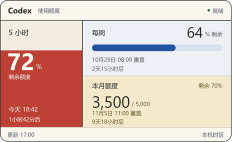
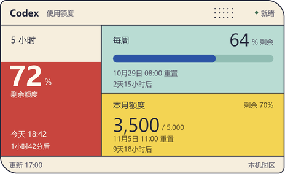

# Codex Usage Rings

Windows 桌面悬浮用量卡片：左侧整格液面显示 **5 小时剩余额度**，右上显示**每周进度**，右下突出**个人月度工作空间余额**。提供**蒙德里安**与**孟菲斯波点**两款可切换风格，默认蒙德里安。中文界面，每 60 秒刷新，支持登录自启动及异常退出恢复。

| 蒙德里安（默认） | 孟菲斯波点 |
| --- | --- |
|  |  |

> 截图使用合成演示数据，不包含真实账号信息。本项目为社区定制版本，与 OpenAI 无隶属或背书关系。来源与许可说明见 [THIRD_PARTY_NOTICES.md](THIRD_PARTY_NOTICES.md)。

## 功能

- 蒙德里安：砖红液面、柔蓝进度区和暖金余额区；孟菲斯波点：奶油底色、珊瑚红、薄荷绿和暖黄。两款均无错位投影。
- 卡片与托盘右键菜单均可切换风格，即时生效，重启后自动恢复选择。
- 全部额度模式约 464 × 284 像素；仅 5 小时或仅每周模式约 398 × 284 像素，仍保留月度余额。
- 液位表示剩余比例，额度变化时平滑升降，拖动后轻晃约 2 秒；文字固定，随液面切换深浅颜色。静止时不循环动画，并遵循 Windows 的动画效果设置。
- 每项保留具体重置日期 / 时间和倒计时。月度区显示大号余额 / 总额与剩余百分比；无数据时显示“额度暂不可用”。
- 拖动、锁定位置、置顶、收起到托盘、手动刷新、单实例运行。
- 使用本机 Codex 登录，不需要另外填写 API key，也不需要复制认证文件。
- 由 Windows 任务计划程序独立启动，守护程序在组件意外退出后重试。

## 环境要求

- Windows 10 / 11。
- Python 3.11+，包含 Tkinter 与同目录下的 `pythonw.exe`。
- 已安装 Codex CLI 或 Codex 桌面客户端，且已通过 ChatGPT 账号登录。
- 网络可用。中文绘图使用 Windows 微软雅黑字体。

月度额度需要账号接口返回 `individualLimit`。没有设置个人月度上限的账号可能不显示该项。

## 安装

在 PowerShell 中克隆到准备长期保留的目录：

```powershell
git clone https://github.com/changyongyu/codex-usage-rings.git
cd codex-usage-rings
python -m venv .venv
.\install.ps1 -PythonPath '.\.venv\Scripts\python.exe'
```

脚本会安装运行依赖、注册当前用户的 `CodexUsageRings` 登录启动任务、创建桌面 **Codex Usage Rings** 快捷方式并启动组件。普通用户权限运行；如设备策略限制任务注册，请按组织策略处理。

首次安装默认展示**蒙德里安**。升级时保留已选风格；旧版本尚未保存风格时使用蒙德里安，并保留位置、锁定和置顶设置。

如果系统阻止运行 `.ps1`，可检查脚本后，仅对本次执行使用：

```powershell
powershell.exe -NoProfile -ExecutionPolicy Bypass -File .\install.ps1 -PythonPath '.\.venv\Scripts\python.exe'
```

`-SkipDependencies` 跳过依赖安装，`-NoStart` 只配置、不立即启动。安装脚本会拒绝覆盖另一目录的同名部署，也会拒绝更新仍在运行的组件。**不要在安装完成后移动源码或虚拟环境目录。**

## 使用

| 操作 | 效果 |
| --- | --- |
| 左键拖动 | 移动；锁定时先右键解锁 |
| 右键 → 展示风格 | 蒙德里安 / 孟菲斯波点，立即切换并保存 |
| 右键 → 显示模式 | 全部额度 / 仅 5 小时 / 仅每周 |
| 右键 → 轻晃液面 | 播放一次短动效；Windows 关闭动画效果时不播放 |
| 右键其他选项 | 刷新、锁定、置顶或退出 |
| 双击卡片 | 收起到托盘 |
| 双击托盘图标 | 恢复窗口 |
| 单击托盘图标 | 全部额度模式下切换托盘显示的 5 小时 / 每周百分比 |
| 右键“退出” | 正常结束组件和本次守护，不会立即重新弹出 |

主动退出后，双击桌面快捷方式可再次打开，下次登录仍会自启动。

收起到托盘后，也可以通过托盘右键的“展示风格”切换。选择会与其他个人设置一起保存在 `widget_pos.json`，下次启动继续使用。

### 读懂额度

- **5 小时 / 每周**：显示账号相应窗口的剩余百分比，不是当前聊天的 token 使用量。
- **月度额度**：工作空间所有者给当前用户设置的个人月度额度，不等于整个工作空间共享余额。
- **颜色**：颜色属于所选风格，低额度时不改变整套配色；低于 20% 时增加“余量低于 20%”文字提示。
- **重置时间**：使用接口返回的实际时间戳和本机时区。5 小时窗口当天 / 次日显示“今天 / 明天 时:分”；每周和月度显示“月日 时:分”，跨年时补充年份。每项均保留倒计时。
- **倒计时**：显示期间每 30 秒更新，不额外查询接口。时间到达后显示“等待额度更新”，不会自行推算新的周期。
- **状态文字**：右上角显示“就绪 / 运行中 / 未检测到 / 检测异常”，由本地事件推断，可能有延迟。查询失败时显示“读取失败”。

用量每 60 秒查询，显示也可能受服务端更新延迟影响。缺失数据与真实的 0% 会分别处理。

## 个性化

切换风格使用右键菜单即可。需要进一步调整时，编辑以下常量后重新启动组件：

| 设置 | 默认值 | 作用 |
| --- | --- | --- |
| `UI_SCALE` | `1.00` | 整体缩放，字体随面板一起缩放 |
| `POLL_SECONDS` | `60` | 查询间隔（秒） |
| `widget_styles.py` 中的 `WIDTH_BOTH` / `HEIGHT` | `464` / `284` | 缩放前设计尺寸 |
| `widget_styles.py` 中的 `RENDER_SCALE` | `4` | 绘图抗锯齿采样倍率，不是界面缩放 |

两款配色与绘制逻辑集中在 `widget_styles.py`。`UI_SCALE` 与 `POLL_SECONDS` 位于 `codex_usage_widget.py`。

## 工作方式

```text
桌面快捷方式 → start_widget.py → Windows 任务 CodexUsageRings
Windows 登录 ───────────────────→ Windows 任务 CodexUsageRings
任务 → launch_supervised.py → codex_usage_widget.py → codex_usage.py → Codex App Server
```

正常数据路径使用 `account/rateLimits/read`，认证交给已安装的 Codex 管理。月度余额使用十进制上限减已用值计算，不写死额度或重置日期。已移除上游直接读取或更新认证文件的旧代码。

## 更新与卸载

更新前先右键退出组件，随后：

```powershell
git pull
.\install.ps1 -PythonPath '.\.venv\Scripts\python.exe'
```

卸载任务和桌面快捷方式：

```powershell
.\uninstall.ps1
```

卸载保留源码、设置和日志，不删除 Codex 登录或会话数据。详细故障排查见 [OPERATIONS.md](OPERATIONS.md)。

## 开发与验证

```powershell
.\.venv\Scripts\python.exe -m unittest discover -s tests -v
.\.venv\Scripts\python.exe scripts\render_preview.py
```

预览脚本使用固定演示数据，一次生成两款风格，不查询账号。本地测试覆盖月度额度解析、默认风格、旧设置兼容、真实 Tk 菜单切换、重启后的选择保留、托盘菜单回调和重置日期 / 倒计时边界。界面测试需要 Windows 图形会话及运行依赖；这些检查不代替多显示器或任务注册的实机验证。当前发布不包含 GitHub Actions 工作流。

## 来源与许可

双圆环和托盘界面基于 [maximevaulch/codex-usage-widget](https://github.com/maximevaulch/codex-usage-widget)；App Server 读取模块基于 [Wannatep/codex-usage-mini-widget](https://github.com/Wannatep/codex-usage-mini-widget)。

上游双圆环项目未提供开源许可证，本项目保留 GitHub fork 来源关系，**不将全部代码重新声明为 MIT 或其他开源许可**。读取模块的原始 Unlicense 文本保存在 [licenses](licenses/codex-usage-mini-widget-UNLICENSE.txt)。各部分权利说明详见 [THIRD_PARTY_NOTICES.md](THIRD_PARTY_NOTICES.md)。

## 隐私

不要上传 Codex 认证文件、日志、个人设置或真实额度截图。项目 `.gitignore` 已排除常见状态文件；公开前仍应检查提交内容。组件日志包含额度与本地诊断信息，分享前请检查。
